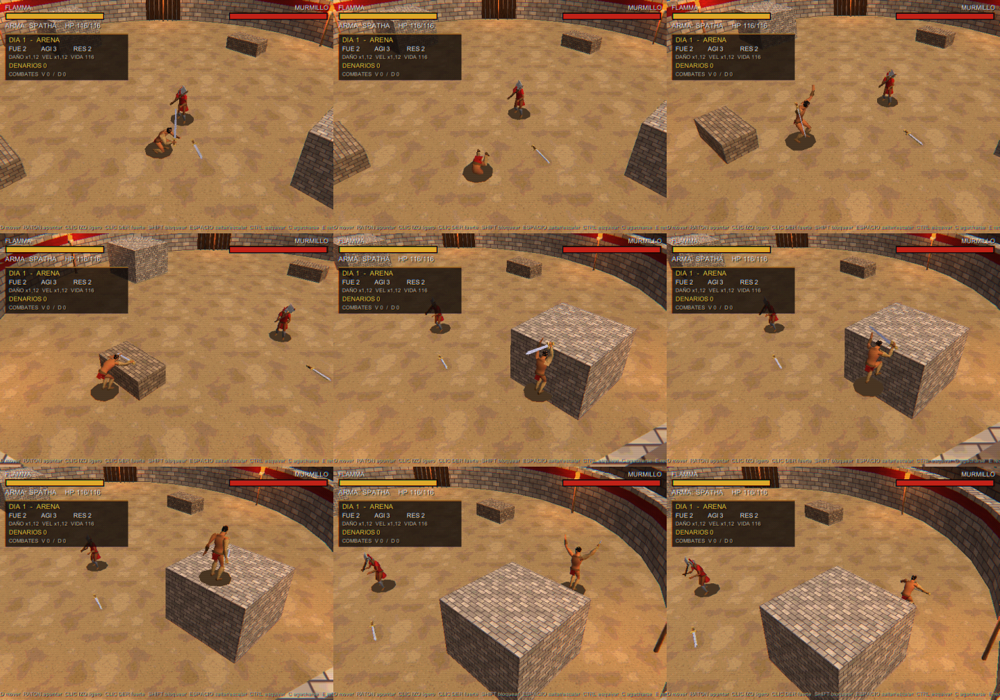
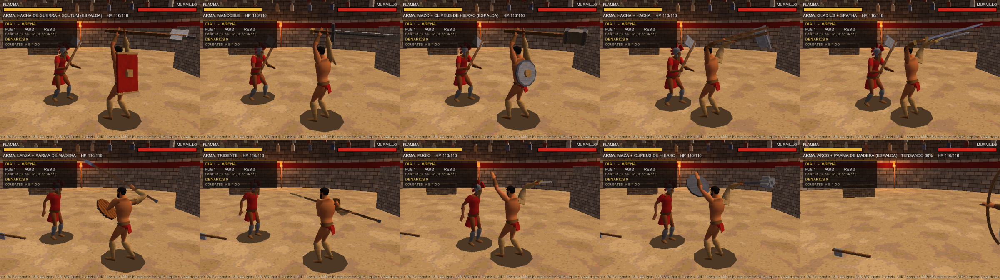
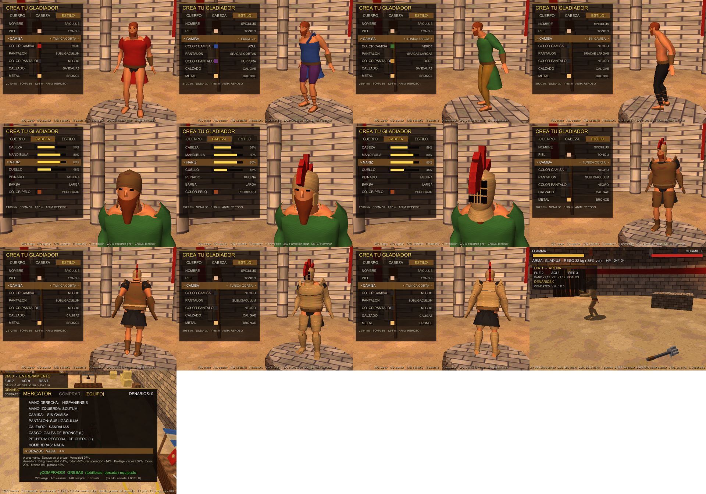
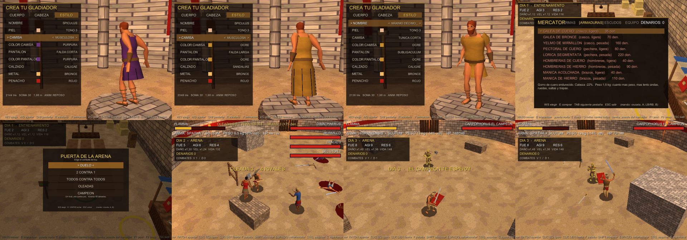
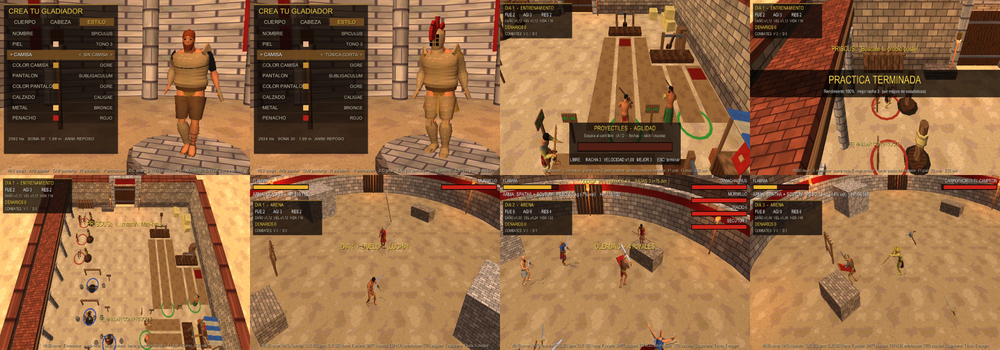

# Coliseo PS2: prototipo (Milestones 1, 2 y 3 + creador de personaje C1 y animaciones MotionBricks C2 y C3)

Unity **6000.5.10f1** · URP 17.5 (renderer Forward) · Input System 1.20

## Jugar sin Unity (descargar el juego)
1. En la página del repositorio, entra en **Releases** y descarga `ColiseoPS2_Windows.zip`.
2. Descomprímelo en cualquier carpeta y abre `ColiseoPS2.exe`. Si Windows avisa con SmartScreen: *Más información → Ejecutar de todas formas*.

## Probar el multijugador con un amigo
1. Los dos descargan el mismo zip de **Releases** (deben tener la misma versión).
2. **Los dos** ejecutan una vez `permitir_cortafuegos.bat` (viene en el zip; pide permisos de administrador). Radmin VPN y
   ZeroTier cuentan como "red pública" en Windows y, sin esto, el cortafuegos bloquea la conexión.
   **El anfitrión**: ESC → MULTIJUGADOR → CREAR PARTIDA. En la sala le salen sus IP con etiqueta (RADMIN VPN, MISMA WI-FI...).
   Una IP `192.168.x.x` o `10.x.x.x` es de red local: **por internet no sirve**.
3. **El amigo** (guía paso a paso en `LEEME_MULTIJUGADOR.txt`):
   - **En la misma red Wi-Fi/LAN**: la partida aparece sola en la lista de MULTIJUGADOR.
   - **Por internet**: lo más fácil es que los dos instalen **Radmin VPN** o **ZeroTier**, entren en la misma red y el amigo
     escriba la IP de Radmin/ZeroTier del anfitrión en **IP DEL ANFITRION** → UNIRSE POR IP. La otra opción es que el anfitrión
     abra el puerto **7777 TCP** en su router y comparta su IP pública.
4. En la sala, el anfitrión pulsa **INICIAR** y entráis los dos al ludus compartido (hasta 4 jugadores).

## Abrir y jugar
1. Pon el proyecto en una **ruta corta** (por ejemplo `C:\Proyectos\ColiseoPS2`). Unity falla con rutas de más de 260 caracteres.
2. Ábrelo desde Unity Hub con 6000.5.10f1.
3. Abre `Assets/_Project/Scenes/Creator.unity` y pulsa Play. Creas tu gladiador y, al terminar, empieza el día 1 en el ludus.
   También puedes abrir `Training.unity` o `Arena.unity` directamente: se usa el último gladiador guardado.
   Si faltan escenas o URP, usa el menú **Gladiator → Configurar todo y abrir el Creador**.

Cada escena solo contiene su bootstrap (`CreatorBootstrap`, `TrainingBootstrap` o `ArenaBootstrap`). Todo lo demás se genera por código al pulsar Play.

## Creador de personaje (C1)
La partida empieza en una sala bajo el ludus, con el gladiador sobre una peana giratoria. Todo es estético: las stats siguen saliendo del entrenamiento.

| Pestaña | Opciones |
|---|---|
| **CUERPO** | Complexión (masculina–femenina), altura (1,52–1,98 m), musculatura, peso, hombros, largo de piernas, largo de brazos |
| **CABEZA** | Tamaño de cabeza, mandíbula, nariz, cuello, peinado (6), barba (4), color de pelo (6). La cámara se acerca a la cara |
| **ESTILO** | Nombre, tono de piel (8), ropa (subligaculum / túnica corta / túnica larga), color de ropa (8), protecciones (manica, grebas), metal (bronce / hierro / oro), casco (galea) y color del penacho |

Controles: W/S elegir fila, A/D ajustar (mantén para deslizar), Tab o LB/RB cambiar de pestaña, R o (X) aleatorio, V o (Y) cambiar la animación de la peana (reposo, andar, correr, lateral, atrás, guardia, ataque ligero, ataque fuerte, bloqueo, impacto y muerte), Z/C, stick derecho o arrastrar con el ratón para girar, Enter o Start para terminar.
El último gladiador se guarda en `PlayerPrefs` y se carga al volver a abrir el juego.

**Cómo está hecho** (`Scripts/Character/`):
- `SomaSkeleton`: el esqueleto de **30 huesos SOMA** que usa NVIDIA MotionBricks, con los mismos nombres y el mismo orden que `soma_n1.json`. La pose de reposo es una T con rotaciones locales a cero, para poder retargetear después los clips generados.
- `BodyMetrics`: convierte los sliders en medidas (posición de las articulaciones, grosor de cada parte).
- `HumanoidBuilder` y `SkinnedMeshBuilder`: generan una sola malla con skinning, de 1.500 a 2.100 triángulos y hasta 7 materiales `PS2_Lit`. La luz ambiental va en los colores de vértice. Se reconstruye entera cada vez que mueves un slider, en unos milisegundos.
- `HumanoidPoser`: mueve el cuerpo con los clips de MotionBricks (ver abajo). Encima, el brazo derecho sigue al `ArmPivot` del combate por IK, la mano izquierda sujeta el escudo y sube la guardia al bloquear sin escudo. Si faltan los clips, usa una animación procedural de reserva.
- Rivales y mercader usan el mismo sistema, con cuerpo aleatorio a partir del nombre.

## Animaciones con NVIDIA MotionBricks (C2)
Las animaciones del cuerpo las ha generado el modelo **MotionBricks SOMA** (`mmm_v6_soma_fp32.onnx`), en CPU con ONNX Runtime. Son 6 clips en bucle en `Assets/_Project/Resources/MotionBricks/`, unos 200 KB en total:

| Clip | Velocidad | Duración |
|---|---|---|
| `idle` | 0 | 2,3 s |
| `walk_f` | 1,6 m/s | 0,8 s |
| `run_f` | 4,2 m/s | 0,9 s |
| `run_b` (atrás) | 3,0 m/s | 0,6 s |
| `run_l` / `run_r` (lateral) | 4,0 m/s | 0,6 s |

**Cómo se generan** (`MotionBricksUnityLab/Bridge/Python/generate_clips.py`, unos 30 s en CPU con 146 inferencias de ~75 ms):
1. Se parte de la pose de reposo del esqueleto SOMA (pose A). Se lee directamente del USD del repositorio, sin instalar nada.
2. Los objetivos solo fijan la trayectoria de la cadera (posición, orientación y velocidad); el cuerpo lo inventa el modelo.
3. Las generaciones se encadenan: los 4 últimos fotogramas son el contexto de la siguiente.
4. A velocidad alta, con solo trayectoria, el modelo deriva en acrobacias. Por eso se guía con poses que él mismo generó antes: la pose de pie guía el andar, y el trote guía las carreras.
5. Cuando la marcha es estable se recorta un ciclo, se cierra el bucle y se exporta.
- **No se usan los clips BVH de ejemplo**, que tienen licencia solo de evaluación. Del BVH solo se lee la jerarquía de huesos (nombres y padres).

Para regenerarlos:
```
cd MotionBricksUnityLab
.venv/Scripts/python.exe -I Bridge/Python/generate_clips.py <ruta>/ColiseoPS2/Assets/_Project/Resources/MotionBricks
```

**En Unity** (`Character/MotionClip.cs`, `HumanoidPoser`):
- **Retargeting:** cada clip guarda, por hueso, la rotación respecto a la pose de reposo SOMA, ya convertida al espacio de Unity. Cada hueso de nuestra pose T se orienta hacia la dirección del mismo hueso en la pose de reposo SOMA. Así vale para cualquier cuerpo del creador.
- **Mezcla por velocidad real:** reposo, andar y correr hacia delante, más carrera atrás y lateral según la dirección. Todos comparten una fase alineada con el apoyo del pie izquierdo.
- **Ritmo:** la velocidad de reproducción se ajusta a la velocidad sobre el suelo y a la altura del personaje, para que los pies no patinen.
- **Uso:** jugador, rivales y mercader usan todos los clips. El creador los muestra en la peana con **V**.
- **Capa de cabeza:** el modelo mira hacia abajo al andar (unos −25°) y hacia arriba al correr (unos +12°). El cuello y la cabeza se corrigen para mirar al rival: el objetivo de la IA o, para el jugador, el rival más cercano; en el ludus, el mercader mira al jugador cuando se acerca. Sin rival, miran al frente un poco hacia abajo. Límites: ±75° de giro y ±35° de inclinación.
- **Giro en el sitio:** al girar parado, el cuerpo da pequeños pasos laterales en vez de rotar sin mover los pies.
- **Orientación de los clips:** cada clip se orienta según la dirección pedida al modelo, no según la media de la cadera. Así la carrera lateral conserva el giro natural de la cadera y su velocidad queda alineada con el eje.

## Animaciones de combate con MotionBricks (C3)
Las poses clave se crean a mano en `MotionBricksUnityLab/Bridge/Python/generate_combat.py`, sobre el esqueleto SOMA y partiendo de la pose de pie que generó el propio modelo. Se crean orientando cadenas de huesos y con IK para que los pies sigan apoyados. MotionBricks rellena el movimiento de todo el cuerpo entre ellas: cambios de peso, pasos y continuación del golpe.
- **Correcciones:** al final de cada tramo se corrige el error que queda para que el movimiento termine exactamente en la pose clave.
- **Coste:** 29 inferencias en CPU, menos de 2 s.

| Clip | Poses clave | Se sincroniza con |
|---|---|---|
| `guard` (bucle) | Guardia: pie del escudo delante, rodillas flexionadas, espada lista | Torso y brazos siempre que lleva arma. Las piernas, solo cuando está quieto |
| `attack_light` | Guardia → armado a la derecha → tajo horizontal → guardia | Windup / Active / Recovery, mediante 2 marcadores |
| `attack_heavy` | Guardia → espada sobre la cabeza → golpe descendente con estocada → guardia | Igual |
| `block` | Guardia → antebrazo y espada en alto, se mantiene | Blocking |
| `stagger` | Guardia → retroceso con los brazos abiertos → guardia | Stagger |
| `death` | Caída de espaldas hasta quedar tumbado | Muerte; sustituye a la caída rígida anterior |

**En Unity** (`HumanoidPoser`, por capas):
1. **Locomoción.**
2. **Guardia** encima mientras lleva arma.
3. **Acción del estado actual:** cada fase del ataque se proyecta sobre su tramo del clip, así que la velocidad de ataque de las stats sigue funcionando. Si se mueve mientras ataca, las piernas siguen corriendo y la acción se aplica sobre todo al torso.
4. **Cabeza** mirando al rival.

Después, el arma se coloca en la mano derecha y el scutum en el antebrazo izquierdo, orientado según el pecho. Los golpes se siguen calculando igual que antes, por distancia y arco. Los minijuegos que mueven el brazo por su cuenta (pesas, palus) usan el IK anterior.

## Movimiento: esquivar, saltar, caer, agacharse, escalar y trepar (C4)
Nueve clips más generados con MotionBricks (`MotionBricksUnityLab/Bridge/Python/generate_moves.py`, 52 inferencias, ~2 s),
con poses clave escritas a mano y el modelo rellenando el movimiento:

| Clip | Mecánica en el juego |
|---|---|
| `dodge` | Rodar (Ctrl / B) hacia donde te mueves: ~2,9 m, invulnerable el 70 % inicial. El giro de 360° lo añade el poser entre las claves de zambullida y levantarse |
| `dodge_back` | Sin dirección: salto atrás de ~1,8 m, también con invulnerabilidad |
| `jump`, `fall`, `land` | Salto real (~0,9 m) con control en el aire; caer de una plataforma usa el bucle de caída y, desde más de 1,3 m, un aterrizaje fuerte que te frena un instante |
| `crouch`, `crouch_walk` | Agachado (C / RT): más bajo y lento; los tajos ligeros (horizontales) pasan por encima, el golpe fuerte sí da |
| `vault` | Escalar: muros de 0,45 a 1,35 m. Manos en el borde, impulso, rodilla arriba y de pie encima |
| `kick` | Patada (F): 6 de daño con cualquier arma, alcance corto, empuja lejos. Pie flexionado (planta al frente) en la extensión. La IA la usa sobre todo contra rivales que bloquean |
| `stunned` | Si te cubres y te dan una patada, se rompe la guardia y quedas **aturdido 2 s** (estrellitas sobre la cabeza): ni moverte, ni atacar, ni cubrirte. Termina antes si te golpean. La IA aprovecha con golpes fuertes |
| `climb` | Trepar: de 1,35 a 2,9 m. Salta, se cuelga, tira, sube la rodilla y queda de pie arriba |

- La arena tiene ahora dos bloques de piedra de 0,9 m y dos plataformas de 2,3 m en las diagonales.
- Los clips de escalar y trepar exportan dónde están las manos en cada clave. Unity coloca al personaje para que las
  manos caigan justo en el borde, sea cual sea la altura del muro y del personaje.
- La IA también esquiva y se agacha como reacción a los ataques, persigue a quien suba a una plataforma (escalando o
  trepando) y baja dejándose caer. Los golpes no alcanzan a quien está a más de 1,2 m de altura de diferencia.
- En el creador, la tecla V muestra también ESQUIVAR, PASO ATRAS, SALTAR, CAER, ATERRIZAR, AGACHARSE, AGACHADO ANDAR,
  ESCALAR y TREPAR.



## Menú de pausa
Esc (o View/Select en el mando) para el juego en cualquier escena y abre:
- **CONTINUAR**.
- **NUEVA PARTIDA**: pide confirmación, borra el progreso de la partida (días, denarios, estadísticas, equipo) y vuelve al creador.
- **SONIDO**: volumen general, música y efectos.
- **GRAFICOS**: pantalla completa o ventana, resolución, límite de FPS (30/60/120/sin límite), VSync, calidad interna
  (448 PS2 / 720 / nativa), filtro PS2 y temblor de vértices.
- **SALIR DEL JUEGO**: pide confirmación.

Se maneja con teclado (W/S, A/D, Enter, Esc), ratón (pasar por encima y clic; en un valor, clic en la mitad izquierda baja y en la
derecha sube) o mando. Las opciones se guardan en PlayerPrefs (`GameSettings`) y se aplican al arrancar.

## Sonido (sintetizado por código)
No hay archivos de audio: todo se genera al arrancar (`Scripts/Audio/`, 22 kHz mono, ~0,6 s los efectos y ~0,3 s cada música).
- **Efectos** (`SoundSynth`): tajos (ligero, fuerte, puño, patada), golpe en carne, golpe fuerte, patada, bloqueo metálico
  (3 variantes), guardia rota, pasos en la arena (4 variantes, uno por zancada real), salto, aterrizaje normal y fuerte,
  rodar, escalar/trepar, aturdido, muerte, recoger o perder el arma, esquiva en falso y clics del menú.
- **Arena**: murmullo del público en bucle, vítores con los golpes fuertes, las guardias rotas y las muertes, cuerno al
  empezar y fanfarria de victoria o cuerno grave de derrota.
- **Música** (`MusicSynth`): lira (Karplus-Strong), tambores y un bordón en modo frigio dominante; una pieza tranquila en el
  creador, otra en el ludus y otra rápida con cuernos en la arena, con fundido entre escenas.
- `AudioManager` escucha los eventos de combate y movimiento, así que no hay que tocar las escenas. Volumen general, música y
  efectos desde el menú de pausa. En pausa se paran los efectos; la música y los clics del menú siguen.

## Arsenal (C5): 12 armas, 3 escudos, dos manos, doble arma y arco
| Arma | Agarre | Notas |
|---|---|---|
| Gladius, Hispaniensis, Spatha | una mano | se pueden llevar dos (combo alternado) |
| Hacha, Maza | una mano | la maza aturde mas al romper una guardia; dos hachas a la vez |
| Pugio (daga) | una mano | muy rapida, poco alcance, +6% velocidad |
| Hacha de guerra, Mazo | dos manos | daño enorme, lentas, -15% / -18% velocidad |
| Mandoble | dos manos | el mayor alcance cuerpo a cuerpo |
| Lanza, Tridente | una o dos | con escudo/otra arma a una mano; libre la izquierda, a dos (+25% daño, +alcance) |
| Arco | dos manos | flechas infinitas; clic izq. rapido, mantener clic der. para tensar (tensado completo rompe guardias) |

- **Escudos**: parma de madera (ligero), scutum (el de antes) y clipeus de hierro (el que mejor bloquea, -7% velocidad).
  Con un arma de dos manos o el arco el escudo va **a la espalda**: no bloquea, pero sigue pesando.
- **Tienda del ludus**: todo se compra al mercator; al comprar se equipa. La pestaña **EQUIPO** (TAB) elige mano derecha y
  mano izquierda (nada, un escudo o una segunda arma de una mano) entre lo que tienes.
- **Arena**: estante (armamentarium) junto al muro oeste con tres armas en la arena. Recoger con E una arma de una mano con la
  izquierda libre la pone en la mano izquierda.
- **Rivales**: arsenal cada vez mas variado (lanzas, tridentes y arcos desde el dia 2; armas a dos manos desde el dia 3), a veces
  con dos armas o con escudo. Los arqueros mantienen la distancia y patean a quien se acerca.
- **Animaciones** (`MotionBricksUnityLab/Bridge/Python/generate_arsenal.py`, 60 inferencias): guardia, tajo, golpe por
  encima de la cabeza y bloqueo a dos manos; estocadas de lanza a una y dos manos; golpe con la izquierda y golpe cruzado
  con dos armas; guardia y disparo con arco. Un IK de brazo pone las dos manos en el mango, y Unity orienta el arma de una
  mano a la otra.



## Ropa y armadura (C6)
**Ropa** (gratis, en el creador y en la pestaña EQUIPO del mercator), con color de camisa y de pantalón:
- Camisas: tunica corta, exomis (sobre un hombro), tunica larga (manga larga) o sin camisa.
- Pantalones: subligaculum, bracae cortas, bracae largas.
- Calzado: sandalias o caligae (atadas a la espinilla).

**Armadura** (se compra al mercator y se equipa pieza a pieza en EQUIPO). Cada hueco tiene una pieza ligera (cuero) y una
pesada (hierro), y hay tres cascos:

| Hueco | Ligera | Pesada |
|---|---|---|
| Casco | galea de cuero (1,5 kg, cabeza -22%), galea de bronce (2,5 kg, -32%) | yelmo de mirmillon cerrado (5 kg, -60%) |
| Pechera | pectoral de cuero (4 kg, torso -20%) | lorica segmentata (9 kg, -45%) |
| Hombreras | cuero (1,5 kg) | hierro (3,5 kg) |
| Brazos | manica acolchada (1,5 kg, -15%) | manica de hierro (4 kg, -32%) |
| Guantes | cuero (0,5 kg) | guanteletes (1,5 kg) |
| Piernas | musleras de cuero (2 kg, -15%) | musleras de hierro (4,5 kg, -30%) |
| Tobilleras | cuero (0,5 kg) | grebas (2 kg, -15%) |
| Botas | cuero (1 kg) | hierro (2,5 kg) |

- **Daño por zona**: cada golpe cae en cabeza, torso, brazos o piernas segun el ataque (los fuertes van mas a la cabeza,
  las patadas a torso y piernas, las estocadas al torso, las flechas repartidas). La armadura de esa zona resta su % (las
  piezas se suman, maximo 75%). Un golpe que da en armadura suena metalico.
- **Peso**: con el juego completo pesado (32 kg) andas un 35% mas lento, ruedas un 40% menos y mas despacio, saltas menos,
  trepas mas lento y te recuperas un 35% mas tarde tras cada ataque. El HUD muestra el peso.
- **Rivales**: siempre con casco; mas piezas cada dia y de hierro a partir del dia 3.



## Modos de arena, oleadas y campeon (C7)
En la puerta norte del ludus, **E** abre el menu de combate:

| Modo | Rivales | Recompensa |
|---|---|---|
| Duelo | 1 | 50 + 15 x dia |
| 2 contra 1 | 2 a la vez | 90 + 20 x dia, +15 por baja |
| Todos contra todos | 3 (cada uno por su cuenta) | 100 + 25 x dia, +15 por baja |
| Oleadas | 1, 2, 4, 6, 8 y 10 | 25 por rival abatido; +200 si superas la sexta |
| Campeon | Carpophorus: armadura de oro completa y tridente; bloquea, esquiva y se agacha mucho mas | 250 + 20 x dia |

- Los caidos se quedan en la arena (con su charco de sangre) hasta que termina el combate; en las oleadas se acumulan.
- Armadura de los rivales (menos el campeon): dias 1-6 sin armadura; dias 7-12 algunos con piezas ligeras; desde el dia 13
  algunos con la armadura pesada completa y otros con piezas ligeras.
- **Tienda**: pestañas ARMAS, ARMADURAS, ESCUDOS y EQUIPO.
- **Ropa nueva**: musculosa, falda corta y falda larga (con pliegues).
- **Nombre propio**: en el creador, fila NOMBRE, ENTER para escribirlo (ENTER o ESC para terminar).
- En el ludus se entrena con un **gladius de madera**.



## Ludus vivo, burlas y sombras (C8)
- **Armadura por lado**: hombreras, brazos, guantes, musleras y tobilleras se pueden llevar en AMBOS lados o solo en el
  IZQ. o el DER. (pestaña EQUIPO; A/D recorre pieza y lado). Una sola pieza pesa y protege la mitad.
- **Camiseta interior**: con pechera u hombreras y sin tunica, va una camiseta gris (cuero) o negra (hierro) debajo.
- **Pestaña ASPECTO** en la tienda: camisa, pantalon, calzado, sus colores, peinado, barba, color de pelo y **color del
  escudo** (como la camisa, rojo, azul, verde, marron, negro, blanco o naranja).
- **Sombras planares**: la silueta del personaje proyectada sobre el suelo (shader `PS2_PlanarShadow`), tambien sobre
  bloques y plataformas.
- **Arqueros**: el disparo rapido hace daño pero ya no interrumpe tu ataque; solo el tensado aturde.
- **Oleadas**: rivales sin armadura y faciles (poca vida, golpean flojo, casi no bloquean).
- **Burlas y festejos** (3 clips nuevos de MotionBricks): los rivales se golpean el pecho o te hacen señas desde lejos y
  luego vuelven a por ti; celebran con los brazos en alto cuando abaten a alguien. Tu: **T** para burlarte.
- **Minijuegos**: al pulsar E eliges ENTRENAR (sube la estadistica, una vez al dia) o PRACTICA LIBRE (sin limite, hasta
  ESC). Agilidad mas corta y rapida: x1 las 5 primeras esquivas, x1,25 las 5 siguientes, x1,5 a las 10 y +0,25 cada 3
  mas; un golpe reinicia la racha y la velocidad.
- **Compañeros**: tres estaciones de cada minijuego; dos de cada una las usan compañeros que entrenan todo el dia. Si les
  pegas con el gladius de madera no pierden vida, solo se quejan. **E** junto a ellos: murmuran algo.



## Desarmar, soltar y lanzar (C9)
- **Desarmar** solo con un **golpe demoledor**: el combo **ligero, ligero, pesado** (seguidos) o **mantener el ataque
  pesado 2 segundos y soltarlo** (el HUD muestra la carga y suena un aviso al estar listo). El golpe demoledor desarma
  siempre al acertar y hace mas daño (x1,2 el combo, x1,5 el cargado). Si el rival se cubre, le rompe la guardia y lo deja
  aturdido 2 s como una patada. Los golpes normales ya no desarman.
- La IA tambien usa el combo y, a veces, el golpe cargado.
- **G**: un toque suelta el arma a tus pies; **mantener G** la lanza girando hacia el rival que tengas delante (hace daño y
  queda en el suelo para recogerla). Mando: cruceta abajo.

## Multijugador (MP1): sala, anfitrion y ludus compartido
- **ESC > MULTIJUGADOR**. Hasta 4 jugadores por red local o IP directa (TCP 7777). Cada uno juega con su gladiador
  guardado (aspecto, nombre, equipo y estadisticas); el multijugador no hace avanzar los dias de la campaña.
- **CREAR PARTIDA**: eres el anfitrion. La sala muestra tu IP para que los demas se unan.
- **Unirse**: las partidas de la misma red aparecen solas en la lista (aviso por UDP 7778); si no, escribe la IP del
  anfitrion en **IP DEL ANFITRION** (E/Enter para escribir, Enter para terminar) y elige **UNIRSE POR IP**.
- **Sala**: lista de jugadores. Solo el anfitrion puede **expulsar** (elige al jugador) e **INICIAR**. Si el anfitrion
  cierra la sala, los demas siguen solos en su ludus.
- **Ludus compartido**: todos aparecen en el patio, con su nombre encima, y se ven moverse, atacar, saltar, rodar y
  burlarse. En el ludus nadie hace daño a nadie. Las estaciones y la tienda funcionan como siempre (si cambias de ropa o
  armadura, los demas lo ven). La puerta de la arena llegara en MP2.
- Por internet: el anfitrion abre el puerto 7777 (TCP) en su router, o usad una VPN de juego (Radmin VPN, ZeroTier).
  La primera vez Windows pregunta por el cortafuegos: permite redes privadas.
- Prueba de dos procesos: `ColiseoPS2.exe -mptest host` y `ColiseoPS2.exe -mptest join` (lineas `[MPTEST]`).

## Camara al hombro y graficos PS2 / PS3
- **Camara clasica: girarla**: manten la rueda del raton (o TAB / R3) y mueve el raton o el stick derecho; un toque rapido la endereza.
- **ESC > CAMARA > TIPO**: CLASICA (camara alta del coliseo, apuntas con el raton) o **AL HOMBRO** (tercera persona
  estilo souls). Al hombro el raton / stick derecho gira la camara, el gladiador mira hacia donde camina y un ataque con
  direccion lo gira al instante. **Fijar objetivo**: clic en la rueda del raton o TAB (mando: R3; la patada pasa a LB).
  Fijado, la camara y el gladiador siguen al rival; mueve el raton / stick de lado para cambiar de objetivo.
  Tambien: SENSIBILIDAD e INVERTIR EJE Y. El cursor se esconde mientras juegas y vuelve en los menus.
- **ESC > GRAFICOS > ESTILO**: **PS2** (el aspecto original) o **PS3**: resolucion nativa, antialiasing 4x, filtrado
  anisotropico, luz por pixel con un poco de brillo y sombras reales y suaves del sol (personajes, armas, bloques y
  muros). En PS3 no se usan la calidad interna ni el filtro PS2.

## Controles: cambiar teclas y botones
- **ESC > CONTROLES**: sensibilidad de la camara y cada accion con su tecla/raton y su boton del mando
  (teclado | mando). Elige una accion y pulsa la tecla, el boton del raton o del mando nuevo; ESC cancela. Si otra
  accion ya la usaba, se intercambian. **RESTAURAR POR DEFECTO** vuelve a las de siempre. Se guarda solo.
- En el mando el movimiento es siempre el stick izquierdo. Por defecto la patada del mando es **LB** y fijar objetivo **R3**.

## El pueblo (Fase 1: geometria)
- Desde el ludus, **puerta este** (junto a las balas de paja): **[E] SALIR AL PUEBLO**. En el pueblo: la **puerta del ludus**
  para volver y la **puerta de la arena** para elegir combate (el mismo menu que la puerta norte del ludus).
- `Town/TownLayout.cs`: el plano como **datos puros** a partir de una semilla (plantilla plaza → calles → casas, rotada
  0/90/180/270, quiza espejada; cada parcela con su tipo, tamaño, colores y puerta). Lista de **lugares** con nombre
  (casas, talleres, plaza, fuente, puestos, puertas) para la simulacion de ciudadanos.
- `Town/TownBuilder.cs`: la geometria low-poly con el mismo shader PS2_Lit, texturas y materiales del ludus, unida en una
  malla por material. Templo, taberna, herreria, panaderia, termas, alfareria, basilica, tiendas, domus, insulae, huertos,
  fuente, mercado, cipreses, antorchas, muralla, coliseo y ludus.
- `Town/TownBootstrap.cs`: la escena `Town`. Semilla guardada por PC (`Gladiator.TownSeed`); `-townseed N` la fuerza.
- Camara clasica: si una casa o muro tapa al jugador, se inclina hacia arriba hasta verlo.
- Prueba: `ColiseoPS2.exe -towntest -townseed 1` (lineas `[TOWNTEST]`).

## El pueblo (Fase 2: ciudadanos como datos)
- `Town/CitizenData.cs`: cada ciudadano es **solo datos** (sin GameObject): nombre, familia, edad, oficio (`Job`), turno
  (`Shift`: manana / tarde / noche), casa (`HomeId`), lugar de trabajo (`WorkId`), relacion contigo (-100..100, se guarda)
  y su horario: filas `ScheduleEntry` = **hora → actividad → lugar**.
- `Town/TownSimulation.cs`: singleton que vive en todas las escenas. Crea **100 ciudadanos** a partir de la semilla del
  pueblo (familias en las casas, un oficio y un sitio de trabajo cada adulto: herreros, panaderos de madrugada, taberneros,
  sacerdotes, guardias de noche, mercaderes, ninos que juegan en la plaza...). Reloj: 1 minuto de juego por segundo real;
  cada dia nuevo (tras un combate) empieza a las 07:00.
- Consultas sin GameObjects:
  - `WhereIs(ciudadano, 14f)` → actividad, lugar, si esta dentro o de camino (y por donde va).
  - `At("plaza", 14f)` → quien esta en la plaza a esa hora. `Near(punto, 40f, hora)` → quien esta fuera cerca (para la fase 3).
  - `Census(hora)`, `ScheduleFor(ciudadano, dia)`, `Describe(ciudadano, dia)`, `ChangeRelation(ciudadano, delta)`.
- En el pueblo: reloj arriba a la derecha. **F3**: panel con lo que hace el pueblo (plaza, fuente, mercado, el ciudadano mas
  cercano y su dia; RePag/AvPag mueven el reloj). **F4**: un poste de color donde esta "logicamente" cada persona que
  esta en la calle (rojo trabajando, amarillo mercado, verde paseando, azul por agua, blanco de camino).

## El pueblo (Fase 3: cuerpos para los que estan cerca)
- `Town/CitizenSpawner.cs`: cada 0,25 s pregunta a la simulacion quien esta **en la calle a menos de 40 m** y le da un
  cuerpo (el mismo humanoide de los gladiadores, con su cara, ropa y edad segun sus datos: ninos mas bajos, ancianos canosos,
  sacerdotes de blanco...). Los que se alejan o entran en casa devuelven el cuerpo y vuelven a ser datos. **Pool de 18
  cuerpos** reutilizables (sin crear ni destruir mientras juegas); si un cuerpo vuelve a la misma persona, no se reconstruye.
- `Town/TownNavMesh.cs`: un navmesh del pueblo hecho al cargar (desde los colliders, ~0,1 s), para que caminen por las
  calles y no atraviesen casas.
- `Town/CitizenNPC.cs`: IA sencilla. Camina a donde le dice la simulacion, espera mirando su sitio (el puesto, la fuente,
  el pueblo desde la puerta), los que pasean dan vueltas por la plaza y los ninos corretean. Te mira cuando estas cerca;
  si te aprecia te vitorea y si te odia se golpea el pecho. **Si le pegas huye** (y los de alrededor tambien) y su relacion
  contigo baja. Al anochecer cada uno vuelve a su puerta y desaparece dentro.
- **[E] HABLAR** con cualquiera: una frase segun lo que hace y lo que piensa de ti (hablar una vez al dia sube un poco la relacion).

## El pueblo (Fase 4: la grada) y la complexion
- `Town/ArenaCrowdManager.cs`: al empezar un combate pregunta a la simulacion quien esta despierto a esa hora y sienta
  **de 30 a 60 vecinos** (los que te adoran o te odian vienen con mas ganas) en las tres primeras filas de la grada, sobre
  todo en el lado que mira la camara, entre el publico pintado (que les deja hueco). Tienen la misma cara y ropa que en el
  pueblo, siguen la pelea con la cabeza y estan "sentados" (agachados). No cuentan para el combate: la IA, la punteria, la
  camara y el fijar objetivo los ignoran (`Fighter.Spectator`).
- Reacciones segun su relacion contigo: los fans se levantan a vitorear tus golpes y cuando cae un rival; los que te odian
  te provocan cuando te golpean y celebran si caes.
- Al terminar, el pueblo lo recuerda: ganar sube lo que piensan de ti los que estaban en la grada (mas los fans), perder lo
  baja, y cada rival que tumbas suma. **Tu fama** (la media del pueblo) sale en el panel F3 y al final del combate.
- **Complexion**: el deslizador COMPLEXION del creador ahora agranda el busto a medida que se acerca a femenina (desde el 35%),
  y la ropa y la armadura lo siguen. En el pueblo, las mujeres tienen complexion del 50% al 100% y los hombres del 0% al 50%.

## Multijugador (MP2): arena online
- **Tu color** (ROJO, VERDE, AZUL, GRIS): ESC > MULTIJUGADOR, en la sala. Es tu equipo en el modo por equipos y el color de
  tu tunica en la arena.
- **El anfitrion** va a la puerta de la arena del ludus (o ESC > MULTIJUGADOR > ARENA ONLINE...) y elige:
  - MODO: **TODOS CONTRA TODOS** (gana el ultimo en pie) o **POR EQUIPOS** (gana el ultimo color en pie; hacen falta dos colores).
  - MEJORAS: **SI** (cada uno con su fuerza, armas, escudo y armadura) o **NO** (todos con gladius, sin armadura, iguales).
- En la arena cada uno aparece alrededor de la arena con su tunica de color; las barras de vida de los rivales salen arriba
  a la derecha. Cada juego decide lo que le pasa a su gladiador: cuando golpeas la copia de otro, tu juego le envia el golpe
  y el suyo lo aplica (su guardia, su esquiva y su armadura cuentan); la vida y las muertes se comparten.
- Al final sale el ganador y, a los pocos segundos, el anfitrion os devuelve a todos al ludus. No da denarios ni pasa el dia.
- En el ludus compartido ahora tambien se ven **las armas que lanza el otro** (vuelan y caen; desaparecen cuando las recoge)
  y **los golpes a los compañeros de entrenamiento** (si uno le pega a Priscus, el otro lo ve quejarse).
- Version de red **COLISEO-MP2**: todos tienen que tener esta misma version del juego.

## El pueblo: casas por dentro
- Las **69 casas** (domus e insulae) se pueden visitar. Cada una tiene su **puerta principal**: acercate y pulsa **E**
  para abrirla o cerrarla (gira hacia dentro sobre su bisagra; cerrada no deja pasar).
- Dentro: **cocina** a la entrada y, detras de un tabique con dos huecos de paso (sin puertas interiores), una
  **habitacion** y un **baño**. Sin decoracion por ahora; el suelo distingue cada estancia (piedra en la cocina,
  madera en la habitacion, baldosa clara en el baño) y al pasar de una a otra sale su nombre en pantalla.
- Al entrar en una casa (o al estar en su puerta) se ocultan su tejado, su techo y sus pisos de arriba, para que la
  camara vea el interior. Los vecinos no entran en las casas por ahora (desaparecen en su puerta, como antes).
- `Town/TownHouse.cs` (`HouseInterior`, `TownDoor`) y `TownBuilder.HomeHouse`.

## El pueblo: guardias, parejas, herrerias y pueblo online
- **Guardia del pueblo**: 16 hombres de guardia como legionarios romanos (tunica roja, galea de bronce, lorica,
  hombreras, grebas, gladius y scutum rojo). Vigilan las puertas de la arena y del ludus las 24 h, las esquinas de la
  plaza, los extremos de la calle transversal y la explanada de la arena.
- **Parejas**: en la mayoria de las casas (~80%) vive una pareja (hombre + mujer), a veces con hijos o un anciano.
- **Dos herrerias** por pueblo, separadas: una en la plaza y otra en la calle del ludus, junto a su puerta. Las marca un **circulo amarillo** en la entrada y un estandarte amarillo: delante de su puerta, **[E] HERRERIA** abre la tienda de armas, armaduras
  y escudos. **El puesto del mercader del ludus ya no existe**: ahora se compra en el pueblo.
- **Faldas y tunicas**: la parte de abajo sigue a cada pierna, asi las piernas ya no atraviesan la falda al andar.
- **Hombros**: barra **POSTURA HOMBROS** en el creador (de ADELANTE a MUY ATRAS; por defecto un poco atras, pecho abierto).
- **Espalda**: nueva barra **ESPALDA** en el creador (pestaña CUERPO): de ENCORVADA a MUY RECTA; por defecto recta.
- **Pueblo online**: desde el ludus compartido cada uno puede salir al pueblo por la puerta este. Todos ven el pueblo del
  anfitrion (misma semilla, mismos vecinos) y su reloj; los jugadores que estan en el pueblo se ven entre si (los que
  siguen en el ludus no aparecen en el pueblo, y al reves); las puertas de las casas que abre uno se abren para todos;
  si alguien le pega a un vecino, huye en todas las pantallas.

## El pueblo: casas en venta y casas de dos pisos
- **4 casas en venta**, una en cada cuarto del pueblo y lejos de la plaza (a 80 m o mas unas de otras). Estan vacias
  (no vive nadie) y tienen un cartel **SE VENDE** junto a la puerta. En la puerta: **[E] COMPRAR ESTA CASA** por su
  precio (250-500 denarios). Comprada, el cartel desaparece, la puerta se abre y es tuya (se guarda; la puerta dice
  "TU CASA").
- **Casas de dos pisos** (las insulae): una **escalera exterior** pegada a un lado de la casa sube desde atras hasta un
  rellano con barandilla, y ahi esta la **puerta del primer piso** (E para abrirla). El primer piso es otra vivienda
  con su cocina, habitacion y baño. Estando abajo se oculta todo lo de arriba; estando arriba, solo el tejado.

## El pueblo: muebles
- Todas las viviendas habitadas (planta baja y primer piso) tienen muebles low-poly hechos por codigo, con el mismo
  estilo PS2 y colision:
  - **Cocina**: una cocina de obra con horno que ocupa todo un costado (la pared sin puerta): encimera de piedra,
    horno con su boca y brasas, chimenea, fuego con olla (luz calida, encendida solo en la casa donde estas), vasijas
    y un estante colgado encima. Mesa con tantas sillas como habitantes (2-4), vela y vasija; estanteria con vasijas.
  - **Baño**: bañera grande de piedra con agua contra la pared del fondo (nunca tapa la entrada), letrina de piedra con canal de agua, vela.
  - **Habitacion**: cama doble si vive una pareja y camas simples para hijos o ancianos, cofre a los pies de la cama,
    comoda (o el cofre) con vela.
- **Una cama por habitacion como maximo**: doble si vive una pareja, simple si vive una persona.
- **Casas grandes** (unas 30, en las manzanas de atras, ~10 x 10 m): cocina, pasillo central, **2 habitaciones**
  (cama doble y cama simple), **2 baños** y un **trastero de 2 x 2 m** al fondo del pasillo con dos estanterias y el cofre.
  Ahi viven las familias de 3; en las casas normales vive una pareja o una persona.
- **Las 4 casas en venta estan vacias** y siguen vacias despues de comprarlas.

## El bucle de juego
**Creador** → **Día N: Ludus** (entrenar, comprar) → **puerta norte** (E duelo / Q todos contra todos) → **Arena** → recompensa → **Día N+1**

- `GameManager` es persistente (`DontDestroyOnLoad`). Guarda el perfil y el `DayCycleManager`.
- El panel de arriba a la izquierda, visible en las dos escenas, muestra:
  - el día y la fase,
  - FUE, AGI y RES,
  - lo que esas stats aportan (daño, velocidad y vida),
  - los denarios,
  - las victorias y derrotas.

## Entrenamiento (Milestone 2)
Cada estación se usa **una vez al día**. Acércate a su círculo de color y pulsa **E / (A)**.

| Estación | Stat | Cómo se juega |
|---|---|---|
| **El Palus** (círculo rojo) | Fuerza | Golpea cuando la marca esté en la zona verde. Son 6 golpes, cada vez más rápidos y con menos zona verde. |
| **Proyectiles** (círculo verde) | Agilidad | Cambia al carril libre (A/D, flechas, stick o cruceta). El carril amenazado se marca en rojo. Son 12 lanzamientos y desde el séptimo pueden venir dobles. |
| **Las Pesas** (círculo azul) | Resistencia | Pulsa repetidamente para llenar la barra antes de 5 s. Son 3 levantamientos, cada uno más pesado. |

Recompensa según el rendimiento: ≥85% da +3, ≥55% da +2 y ≥25% da +1.

## Progresión (Milestone 3)
### Las stats afectan al combate (`Progression/StatEffects.cs`)
| Stat | Efecto por punto |
|---|---|
| Fuerza | Daño +6% |
| Agilidad | Velocidad de ataque +4% (hasta ×1,6) y velocidad de movimiento +0,06 m/s |
| Resistencia | Vida máxima +8 (base 100) |

Los rivales también mejoran cada día: más vida, más daño y más velocidad. A partir del día 3, cada rival tiene un 40% de probabilidad de llevar escudo.

### Denarios
| Resultado | Recompensa |
|---|---|
| Ganar un duelo | 50 + 15 × día |
| Ganar todos contra todos | 100 + 25 × día |
| Perder | 10 |
| Cada rival que remates tú | +15 |

### Tienda (`Progression/ShopCatalog.cs`, `UI/ShopMenu.cs`)
El puesto del mercader está en la esquina sureste del ludus (círculo dorado). Controles: W/S para elegir, E para comprar y Esc o Q para salir. En mando: cruceta, A y B.

| Objeto | Precio | Efecto |
|---|---|---|
| **Scutum** (escudo) | 75 | Bloquea el 97% del daño ligero y el 80% del fuerte (sin escudo: 90% y 60%). La guardia rota dura 0,35 s en vez de 0,6. Tienes la mitad de probabilidad de ser desarmado. El escudo se coloca delante del cuerpo al bloquear. |
| **Gladius Hispaniensis** | 140 | Daño 15/33 (el gladius hace 11/24), más alcance y un 10% más rápida. Sustituye al gladius en la arena. |

Al comprar, el objeto se equipa automáticamente. No se puede comprar dos veces.

### Todos contra todos
En la puerta norte, pulsa **Q / (Y)**. Te enfrentas a 3 rivales, cada uno en su propio equipo, así que también luchan entre ellos. Cada rival es algo más débil que en un duelo. Para que no te ataquen los tres a la vez, la IA reparte los objetivos.

## Controles
| Acción | Teclado/Ratón | Mando (Xbox) |
|---|---|---|
| Mover | WASD / flechas | Stick izq. |
| Apuntar (arena) | Ratón | Stick der. (sin él, el personaje apunta solo al enemigo más cercano) |
| Ataque ligero | Clic izq. / J | X |
| Ataque fuerte | Clic der. / K | Y |
| Patada (rompe la guardia y empuja; sirve para tirar a alguien de una plataforma) | F | R3 (clic stick der.) |
| Bloquear (mantener) | Shift | RB / LB / LT |
| Arco: tensar (mantener clic der.) y soltar para disparar | Clic der. / K | Y |
| Golpe demoledor (desarma): mantener 2 s y soltar | Clic der. / K | Y |
| Soltar arma (toque) / lanzarla (mantener) | G | Cruceta abajo |
| Burla | T | Cruceta arriba |
| Saltar / escalar / trepar | Espacio | A (si no hay arma que recoger) |
| Esquivar (rodar hacia donde te mueves; sin dirección, paso atrás) | Ctrl izq. | B |
| Agacharse (mantener) | C | RT |
| Interactuar / recoger / menu de la puerta de la arena | E | A |
| Volver al ludus (tras el combate) | E / Enter / R | A / Start |
| Post-proceso PS2 / vertex snapping (empiezan apagados) | F1 / F2 | |
| Menú de pausa (o cerrar la tienda) | Esc | View / Select |

## Estilo PS2
- `PS2_Lit`: iluminación por vértice. La luz ambiental está guardada en los colores de vértice. Incluye niebla y vertex snapping.
- `PS2_Post`: el juego se dibuja a 448 líneas y se escala sin suavizar. Encima lleva dithering Bayer, scanlines y aberración cromática.
- Texturas procedurales de 64 o 128 px sin mipmaps. Sin MSAA, sin HDR y sin sombras en tiempo real.
- La UI es plana y se dibuja a baja resolución, así que el texto sale pixelado.

## Smoke test automático
```
Builds/Win64/ColiseoPS2.exe -autotest -screen-width 1280 -screen-height 896 -screen-fullscreen 0
```
Primero pasa por el creador: comprueba que el esqueleto es el SOMA de 30 huesos y que se cargan los clips de MotionBricks (`[MOTION]`), prueba el menú, los valores mínimos y máximos, 3 cuerpos aleatorios, la cara con melena, barba y casco y las 5 animaciones en la peana, y termina con un gladiador fijo (líneas `[CREATOR]`, capturas `autotest_c*.png`). Este gladiador no se guarda en `PlayerPrefs`.

Después un bot juega cuatro días seguidos:
1. **Día 1:** 3 entrenamientos, intento de compra sin dinero y duelo.
2. **Día 2:** entrena, compra el escudo y juega todos contra todos.
3. **Día 3:** entrena, compra la espada y juega un duelo.
4. **Día 4:** comprueba que todo se ha conservado.

Si el bot pierde y no le llega el dinero, se le añade lo que falta (lo indica la línea `GRANT` del log) para poder probar la compra igualmente.

El log incluye líneas `[CREATOR]`, `[AUTOTEST]`, `[TRAINING]`, `[ARENA]` y `[SHOP]`. Las capturas `autotest_*.png` se guardan junto al exe.

## Batch (CI)
```
Unity.exe -batchmode -projectPath <ruta> -executeMethod Gladiator.EditorTools.GladiatorProjectSetup.BatchSetup
Unity.exe -batchmode -projectPath <ruta> -executeMethod Gladiator.EditorTools.GladiatorProjectSetup.BatchBuild
```
